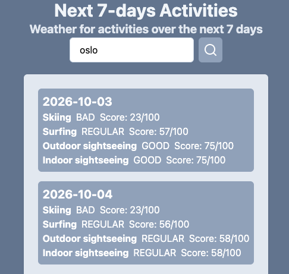
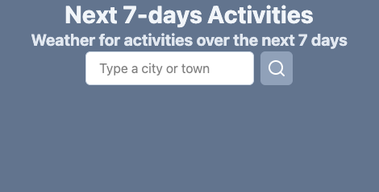
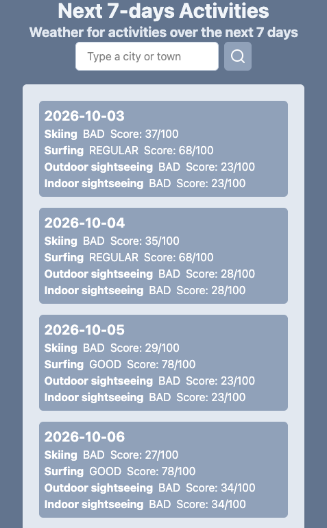
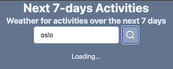

# Full-Stack Engineer Take-Home Exercise

This is a full-stack engineer project for a company to evaluate my skills in Node.js, GraphQL and a front-end implementation of my choice.
The functional specification involves creating a service and an interface that based on a given city or town, rank how good the next 7 days will be for the following activities: skiing, surfing, outdoor sightseeing and indoor sightseeing.

<p align="center">
    
</p>

## Table of Contents
- [1. Installation](#installation)
- [2. Deploy](#deploy)
- [3. Implementation Steps](#implementation-steps)
- [4. Stack](#stack)
- [5. Back-end Architecture](#back-end-architecture)
- [6. Front-end Architecture](#front-end-architecture)
- [7. Project Construction](#project-construction)
    - [7.1 NPM Initialization](#npm-initialization)
    - [7.2 NPM Script](#npm-script)
    - [7.3 NPM Packages](#npm-packages)
    - [7.4 Gitignore file](#gitignore-file)
    - [7.5 Env file](#env-file)
    - [7.6 Entry point file](#entry-point-file)
    - [7.7 GraphQL Express Route](#graphql-express-route)
    - [7.8 GraphQL Schema and Resolvers](#graphql-schema-and-resolvers)
- [8. Open-Meteo API](#open-meteo-api)
- [9. How the React Front-End Was Made](#how-the-react-front-end-was-made)
- [10. AI Usage](#ai-usage)


## Installation

1. Clone repository
```bash
git clone https://github.com/jjuniorc/cg-full-stack-engineer-test.git
```

2. Install dependencies
```bash
npm install
```

3. Create environment file
```bash
cp .env.example .env
```

4. Run the back-end application
```bash
npm run dev
```

5. Start back-end application in production
```bash
npm start
```

6. Run the front-end application
```bash
cd front-end
npm run dev
```

7. Build the front-end application for production
```bash
cd front-end
npm run build
```
*Note*: The front-end package will be mounted at front-end/dist directory.

*Important*: This command step must be executed if you want to access the front-end directly from the back-end.

## Deploy
I let a Docker + Docker Compose prepared to start and stop the container. Below are the commands to handle build deploy.

1. Build and start
```bash
docker compose up --build -d
```
After this command you should be able to browse at the address http://localhost:3001

2. Follow logs
```bash
docker compose logs -f
```
All backend Node.js console text should be displayed. You can use CTRL+C to exit.

3. Check container health/status
```bash
docker compose ps
```

4. Stop and remove the container
```bash
docker compose down
```

*Notes*: 
- All commands must run at the project root directory.
- Ensure the port 3001 is free to be used.


## Implementation Steps
__This section demonstrates a total of 33 bullets with explanation about how I planned each step, the decisions I made and how I built everything from scratch.__

1. I created a repository on GitHub.
2. Then, I set up the project structure to handle a fixed GraphQL route (version) using ExpressJS. See *Project Construction* section.
3. I took a look at the Open-Meteo documentation: https://open-meteo.com/en/docs
4. Following the Open-Meteo documentation under the TypeScript section, I created module file to read Open-Meteo with a simulated request.
```js
import { fetchWeatherApi } from "openmeteo";

export async function getForecast()
{
    const params = {
	    latitude: 52.52,
	    longitude: 13.41,
	    hourly: ["temperature_2m", "relative_humidity_2m"],
    };

    const url = process.env.OPENMETEO_URL;
    const responses = await fetchWeatherApi(url, params);
    
    const response = responses[0];

    const result = {
        "latitude": response.latitude(),
        "longitude": response.longitude(),
        "elevation": response.elevation(),
        "utcOffsetSeconds": response.utcOffsetSeconds(),
    }
    console.log(result);
}
```

5. I called the simulated function to test directly at the entry point after the server started.
```js
app.listen(PORT, () => {
    console.log(`Listening on port ${PORT}`);

    getForecast();
});
```

6. I saw the output below in the terminal, validating the call. Then I removed the test entry point call.
```js
{
    latitude: 52.52000045776367,
    longitude: 13.419998168945312,
    elevation: 38,
    utcOffsetSeconds: 0
}
```

7. Using the VSCode integrated AI code agent Cline (Plan mode) configured with DeepSeek V4.1 Flash, I made the following question:
> Since I have the getForecast function in the file local_modules/openmeteo.js integrated to Open-Meteo API. How can I rebuilt this function to receive a city or town as the function input parameter to get the weather information for the informed region?

8. The AI answer was to use the Open-Meteo Geocoding API (https://open-meteo.com/en/docs/geocoding-api) to search by location name and capture the latitude/longitude from the response before calling the fetchWeatherApi. I saw its implementation and I adapted to the following function:
```js
async function geocode(city)
{
    const url = new URL(process.env.OPENMETEO_GEOCODING_URL);
    url.searchParams.set("name", city);
    url.searchParams.set("count", "1");
    url.searchParams.set("language", "en");
    url.searchParams.set("format", "json");

    const response = await fetch(url);

    if(!response.ok)
    {
        console.error(`Geocode failed: ${response.status}`);
        return null;
    }

    const data = await response.json();

    if(!data.results)
    {
        console.warn(`No location found for the city ${city}`);
        return null;
    }

    if(data.results.length == 0)
    {
        console.warn(`No location found for the city ${city}`);
        return null;
    }

    const result = data.results[0];

    return result;
}
```

9. I rebuilt the getForecast export function to receive the location name (city parameter):
```js
export async function getForecast(city)
{
    if(!city)
    {
        console.warn(`A location name is required for forecast function`)
        return null;
    }

    const location = await geocode(city);

    if(!location)
    {
        return null
    }

    const params = {
	    latitude: location.latitude,
	    longitude: location.longitude,
	    hourly: ["temperature_2m", "relative_humidity_2m"],
    };

    ...
}
```

10. I tested again locally to see the output and validate if the new implementation passes without errors.
```js
app.listen(PORT, () => {
    console.log(`Listening on port ${PORT}`);

    getForecast(`São Paulo`);
    getForecast(`Tokyo`);
});
```

Output:
```js
{
  latitude: -23.514938354492188,
  longitude: -46.610504150390625,
  elevation: 745,
  utcOffsetSeconds: 0
}
{
  latitude: 35.70000076293945,
  longitude: 139.6875,
  elevation: 40,
  utcOffsetSeconds: 0
}
```

11. As requested to get the next 7 days, I see in the documentation the input parameter "daily", a string array with a list of daily weather variable aggregations. 
The documentation says the timezone parameter become required when the daily parameter is informed.
I prepared the implementation with this new parameter:
- Variables to test: I got from the documentation Daily Parameter Definition section the parameters temperature_2m_max, temperature_2m_mean and temperature_2m_min.
- I asked to Claude AI: How to read the result from daily() method using Javascript? (Based on my call as example) 
- Based on the TypeScript example in documentation and the AI response, I set a result object array with day (time) and temperature.
```js
export async function getForecast(city)
{
    ...

    const params = {
	    latitude: location.latitude,
	    longitude: location.longitude,
        timezone: location.timezone,
	    daily: ["temperature_2m_max", "temperature_2m_mean", "temperature_2m_min"],
    };

    ...

    const response = responses[0];
    
    const daily = response.daily();
    
    const temperature_2m_max = daily.variables(0).valuesArray();
    const temperature_2m_mean = daily.variables(1).valuesArray();
    const temperature_2m_min = daily.variables(2).valuesArray();

    const days = temperature_2m_max.length;
    const start = Number(daily.time());
    const step = daily.interval();

    const dailyInfo = [];
    
    for(let ix = 0; ix < days; ix++)
    {
        dailyInfo.push({
            "time": new Date((start + ix * step) * 1000).toISOString().slice(0, 10), // YYYY-MM-DD
            "temperature_2m_max": temperature_2m_max[ix],
            "temperature_2m_mean": temperature_2m_mean[ix],
            "temperature_2m_min": temperature_2m_min[ix]
        })
    }

    const result = {
        "name": location.name,
        ...
        "dailyInfo": dailyInfo
    }
    console.log(result);
}
```

Output:
```js
{
  name: 'São Paulo',
  latitude: -23.514938354492188,
  longitude: -46.610504150390625,
  elevation: 745,
  utcOffsetSeconds: -10800,
  dailyInfo: [
    {
      time: '2026-10-03',
      temperature_2m_max: 24.149999618530273,
      temperature_2m_mean: 18.19583511352539,
      temperature_2m_min: 14.75
    },
    {
      time: '2026-10-04',
      temperature_2m_max: 24.350000381469727,
      temperature_2m_mean: 20.295835494995117,
      temperature_2m_min: 17.100000381469727
    },
    ...
  ]
}
```

12. The next step is to understand which parameters/values might be ideal for required activities Skiing, Surfing, Outdoor sightseeing, Indoor sightseeing. The before check it I see as a good practice to set functions for each activity in a separated module, once each could use different rules to be evaluated: local_modules/activities.js
```js
export async function next7DaysSki(city)
{

}

export async function next7DaysSurf(city)
{
    
}

export async function next7DaysOutdoor(city)
{
    
}

export async function next7DaysIndoor(city)
{
    
}
```

And I changed the getForecast function to receive the daily parameter from outside, since each activity should define its requirements. The getForecast result now send the variables through dailyVariables.
*Note*: I used the Cline AI tool to understand the daily.variables must use bind method with daily.

```js
export async function getForecast(city, dailyParams)
{
    ...
    const params = {
	    latitude: location.latitude,
	    longitude: location.longitude,
        timezone: location.timezone,
        daily: dailyParams
    };
    ...

    const result = {
        "name": location.name,
        "latitude": response.latitude(),
        "longitude": response.longitude(),
        "elevation": response.elevation(),
        "utcOffsetSeconds": response.utcOffsetSeconds(),
        "dailyVariables": daily.variables.bind(daily),
        "dailyStart": Number(daily.time()),
        "dailyStep": daily.interval(),
    }
    
    return result;
}
```

13. Before asking for AI help, I made a pre-defined calling supposing the mean temperature between 19 and 35 degrees to be ideal for surfing. As request the output must be a rank, to simplify I've defined it with 3 basic values. Bad, Regular and Good:
- Lower than 19: Bad
- Between 19 and 22: Regular
- Over 22: Good

```js
export async function next7DaysSurf(city)
{
    const dailyParams = ["temperature_2m_mean"];
    const forecast = await getForecast(city, dailyParams);

    const result = {
        "days": []
    }

    if(!forecast)
    {
        return result;
    }

    if(!forecast.dailyVariables)
    {
        return result;
    }

    const temperature_2m_mean = forecast.dailyVariables(0).valuesArray();

    const days = temperature_2m_mean.length;
    const start = forecast.dailyStart;
    const step = forecast.dailyStep;

    for(let ix = 0; ix < days; ix++)
    {
        const meanTemp = temperature_2m_mean[ix];

        let rank = "REGULAR";

        if(meanTemp < 19)
        {
            rank = "BAD";
        }
        else if (meanTemp > 22)
        {
            rank = "GOOD";
        }

        result.days.push({
            "day": ix + 1,
            "date": new Date((start + ix * step) * 1000).toISOString().slice(0, 10), // YYYY-MM-DD 
            "rank": rank,
            "mean_temperature": meanTemp
        })
    }

    return result;
}
```

14. With this pre-defined calling model I asked for AI code agent Cline (plan mode) the following: 
> I need to build a service to rank how good the next 7 days will be for each of these activities: Skiing, Surfing, Outdoor sightseeing, Indoor sightseeing. I've mounted the initial logic into local_modules/activities.js visually validated using entry point console.log (index.js). I need you to help me to think what Open-Meteo daily parameters and values are ideal to mount each activity rank properly, like temperature, rain, snowfall, daylight duration, wind speed, etc. 

The AI answer recommends a weighted 0–100 score built from per-factor sub-scores, then mapped to existing 3 tiers: `<40 → BAD`, `40–69 → REGULAR`, `≥70 → GOOD`. Keeping the existing output contract but making each factor's contribution explicit and tunable.
The AI recommendation is to make a shared scoring module in a new local_modules/ranking.js file with functions:
- piecewiseScore: Map a daily weather value to a sub-score.
- weightedScore: Combine weighted sub-scores into a single 0..100 score.
- scoreToRank: Translate a 0..100 score into the public rank tiers.
- weatherSeverity: Severity (0..100) for a WMO (World Meteorological Organization) weather code
- roundScore: Round a score for output.

15. I asked for AI how can be implemented for the next7DaysSurf function. The AI response's for surfing was scoring over:
- windSpeed
- windGusts
- weatherCode
- precipitation
- meanTemp

16. In the same module a helper function was implemented: surfWeatherScore. This function evaluates weather conditions for surfing using WMO code and set a fixed score depending on weather condition:
- isThunderstorm: 20 (Dangerous)
- isFog: 80
- isRainShowers: 75
- isRain: 60
- isDrizzle: 55
- isSnow: 30
- isClear: 65
- None of above: 70 (Partly cloudy / overcast)

17. The next7DaysSurf function was rebuilt to use the new scoring module and the surfWeatherScore helper function. The final output is a rank for each of the next 7 days based on the calculated score and weight for each evaluation like wind speed, wind gusts, etc.
```js
export async function next7DaysSurf(city)
{
    const dailyParams = [
        "temperature_2m_mean",
        "wind_speed_10m_max",
        "wind_gusts_10m_max",
        "weather_code",
        "precipitation_sum"
    ];

    const forecast = await getForecast(city, dailyParams);

    const result = {
        "days": []
    }

    if(!forecast)
    {
        return result;
    }

    if(!forecast.dailyVariables)
    {
        return result;
    }

    // Read each requested variable once. Open-Meteo preserves the order of
    // dailyParams in the response, so every column name maps to its own values.
    const columns = {};

    dailyParams.forEach((name, position) => {
        columns[name] = forecast.dailyVariables(position).valuesArray();
    });

    const days = columns['temperature_2m_mean'].length;
    const start = forecast.dailyStart;
    const step = forecast.dailyStep;

    for(let ix = 0; ix < days; ix++)
    {
        const meanTemp = columns.temperature_2m_mean[ix];
        const windSpeed = columns.wind_speed_10m_max[ix];
        const windGusts = columns.wind_gusts_10m_max[ix];
        const weatherCode = columns.weather_code[ix];
        const precipitation = columns.precipitation_sum[ix];

        // Wind drives both swell generation and surface texture, so it carries
        // the most weight; the weather system and comfort fill in the rest.
        const score = weightedScore([
            {
                "score": piecewiseScore(windSpeed, [
                    { "upTo": 8, "score": 60 },          // glassy but often flat
                    { "upTo": 20, "score": 85 },         // workable, some texture
                    { "upTo": 30, "score": 55 },
                    { "upTo": 45, "score": 30 },
                    { "upTo": Infinity, "score": 0 }     // blown out
                ]),
                "weight": 0.40
            },
            {
                "score": piecewiseScore(windGusts, [
                    { "upTo": 25, "score": 100 },
                    { "upTo": 40, "score": 70 },
                    { "upTo": 55, "score": 40 },
                    { "upTo": Infinity, "score": 10 }    // choppy
                ]),
                "weight": 0.20
            },
            {
                "score": surfWeatherScore(weatherCode),
                "weight": 0.20
            },
            {
                "score": piecewiseScore(precipitation, [
                    { "upTo": 0, "score": 60 },
                    { "upTo": 5, "score": 70 },          // system energy
                    { "upTo": 15, "score": 60 },
                    { "upTo": Infinity, "score": 35 }    // heavy mess
                ]),
                "weight": 0.10
            },
            {
                "score": piecewiseScore(meanTemp, [
                    { "upTo": 5, "score": 40 },          // cold, wetsuit required
                    { "upTo": 10, "score": 60 },
                    { "upTo": 18, "score": 80 },
                    { "upTo": Infinity, "score": 100 }   // mild
                ]),
                "weight": 0.10
            }
        ]);

        result.days.push({
            "day": ix + 1,
            "date": new Date((start + ix * step) * 1000).toISOString().slice(0, 10), // YYYY-MM-DD
            "rank": scoreToRank(score),
            "score": roundScore(score),
            "metrics": {
                "wind_speed_10m_max": windSpeed,
                "wind_gusts_10m_max": windGusts,
                "precipitation_sum": precipitation,
                "temperature_2m_mean": meanTemp,
                "weather_code": weatherCode
            }
        })
    }

    return result;
}
```

Output:
```json
{ "days": [ { "day": 1, "date": "2026-10-03", "rank": "GOOD", "score": 78,
              "metrics": { "wind_speed_10m_max": 14.2, "wind_gusts_10m_max": 22.5,
                           "precipitation_sum": 0.4, "temperature_2m_mean": 19.1,
                           "weather_code": 2 } } ] }
```

18. I mounted the ski score functions. I asked to AI for skiWeatherScore function which scoring table is the most accurate. Similar for Outdoor and Indoor I asked: What's the best approach to make functions for Outdoor sightseeing and Indoor sightseeing.
The AI recommends me to use a shared params for both sightseeing and a shared helper function: buildSightseeingDays. 

The module calls to test each activity are:
```js
const surf = await next7DaysSurf(`Ibiza`);
const ski = await next7DaysSki(`Nevados de Chillán`);
const outdoor = await next7DaysOutdoor(`Paris`)
const indoor = await next7DaysIndoor(`Tokyo`)
```

19. With the business layer mounted my action was wiring the GraphQL to responding the next 7 days rank from a city name. I added to GraphQL schemas the following.
```graphql
    type RankDay {
        day: Int!,
        date: String!,
        rank: String!,
        score: Float!
    }

    type RankData {
        days: [RankDay!]!
    }
    
    type ActivityRankData {
        skiing: RankData!,
        surfing: RankData!,
        outdoor: RankData!,
        indoor: RankData!
    }

    type RootQuery {
        version: VersionData!
        activityRank(city: String!): ActivityRankData!
    }
```

Then I added to resolvers the following function:
```js
    activityRank({ city })
    {
        return {
            skiing: next7DaysSki(city),
            surfing: next7DaysSurf(city),
            outdoor: next7DaysOutdoor(city),
            indoor: next7DaysIndoor(city)
        }
    }
```

20. Then the GraphQL Query was able to respond all activities by a city name:
```graphql
{
    activityRank(city: "Tokyo") {
        skiing  { days { day date rank score } }
        surfing { days { day date rank score } }
        outdoor { days { day date rank score } }
        indoor  { days { day date rank score } }
    }
}
```

Using CURL:
```bash
curl --location 'http://localhost:3001/graphql' \
  --header 'Content-Type: application/json' \
  --data "$(jq -n --arg query '
{
  activityRank(city: "Tokyo") {
    skiing  { days { day date rank score } }
    surfing { days { day date rank score } }
    outdoor { days { day date rank score } }
    indoor  { days { day date rank score } }
  }
}' '{query: $query}')"
```

The Output was:
```json
{"data":{"activityRank":{"skiing":{"days":[{"day":1,"date":"2026-10-03","rank":"BAD","score":37}...,{"day":2,"date":"2026-10-04","rank":"BAD","score":35},{"day":3,"date":"2026-10-05","rank":"BAD","score":29},{"day":4,"date":"2026-10-06","rank":"BAD","score":27},{"day":5,"date":"2026-10-07","rank":"BAD","score":32},{"day":6,"date":"2026-10-08","rank":"BAD","score":38},{"day":7,"date":"2026-10-09","rank":"BAD","score":27}]},"surfing":{"days":[{"day":1,"date":"2026-10-03","rank":"REGULAR","score":68},{"day":2,"date":"2026-10-04","rank":"REGULAR","score":68},{"day":3,"date":"2026-10-05","rank":"GOOD","score":78},{"day":4,"date":"2026-10-06","rank":"GOOD","score":78},{"day":5,"date":"2026-10-07","rank":"GOOD","score":82},{"day":6,"date":"2026-10-08","rank":"GOOD","score":83},{"day":7,"date":"2026-10-09","rank":"GOOD","score":78}]},"outdoor":{"days":[{"day":1,"date":"2026-10-03","rank":"GOOD","score":95},{"day":2,"date":"2026-10-04","rank":"GOOD","score":89},{"day":3,"date":"2026-10-05","rank":"GOOD","score":97},{"day":4,"date":"2026-10-06","rank":"GOOD","score":91},{"day":5,"date":"2026-10-07","rank":"GOOD","score":89},{"day":6,"date":"2026-10-08","rank":"GOOD","score":100},{"day":7,"date":"2026-10-09","rank":"GOOD","score":96}]},"indoor":{"days":[{"day":1,"date":"2026-10-03","rank":"BAD","score":23},{"day":2,"date":"2026-10-04","rank":"BAD","score":28},{"day":3,"date":"2026-10-05","rank":"BAD","score":23},{"day":4,"date":"2026-10-06","rank":"BAD","score":34},{"day":5,"date":"2026-10-07","rank":"REGULAR","score":40},{"day":6,"date":"2026-10-08","rank":"BAD","score":20},{"day":7,"date":"2026-10-09","rank":"BAD","score":28}]}}}}
```

21. After the back-end implementation I started the front-end project in the subfolder ./front-end using the React Vite setup. See the section *React Front-End Setup* in this README.

22. Then I edited the ./front-end/vite.config.ts to add the Tailwind and the proxy to the backend.
```ts
import tailwindcss from '@tailwindcss/vite'
import react from '@vitejs/plugin-react'
import { defineConfig } from 'vite'

// https://vite.dev/config/
export default defineConfig({
  plugins: [react(), tailwindcss()],
  server: {
    proxy: {
      '/graphql': {
        target: 'http://localhost:3001',
        changeOrigin: true,
      },
    },
  },
})
```

23. Into the ./front-end/src/index.css I imported the tailwindcss:
```css
@import "tailwindcss";
```

24. I cleaned up the demonstration code from index.css, App.css and App.tsx.

25. In the App.tsx I set an initial layout with responsive layout and an application title
```tsx
import './App.css'

function App() {
    return (
        <div className="w-screen min-h-screen bg-slate-500 justify-center p-6">
            <h1 className="text-3xl text-slate-100 font-bold text-center">Next 7-days Activities</h1>
            <h2 className="text-xl text-slate-200 font-bold text-center">Weather for activities over the next 7 days</h2>
        </div>
    )
}

export default App
```

26. I created a search box component with a input text and a button, into the directory ./front-end/src/components/SearchBox.tsx.
```tsx
import { SearchIcon } from "lucide-react";

interface SearchBoxProps
{
    searchValue: string;
    setSearchValue(value: string): void;
    onSearchButtonClick(): void;
}

function SearchBox({searchValue, setSearchValue, onSearchButtonClick}: SearchBoxProps)
{
    function OnCityOrTownChange(value: string)
    {
        setSearchValue(value);
    }

    return (
        <div className="flex gap-2">
            <input
                className="border border-slate-300 outline-slate-400 bg-white px-4 py-2 rounded-md"
                placeholder="Type a city or town"
                aria-label="City or town"
                value={searchValue}
                onChange={(event) => { OnCityOrTownChange(event.target.value) }}
             />
             <button className="bg-slate-400 text-white p-2 rounded-md"
                onClick={() => {onSearchButtonClick()}}
             >
                <SearchIcon />
            </button>
        </div>
    )
}

export default SearchBox
```

27. I applied the component to the App.tsx:
```tsx
import { useState } from 'react'
import './App.css'
import SearchBox from './components/SearchBox'

function App() {

    const [searchValue, setSearchValue] = useState("");
    
    function onSearchButtonClick()
    {

    }

    return (
        <div className="w-screen min-h-screen bg-slate-500 p-6">
            <h1 className="text-3xl text-slate-100 font-bold text-center">Next 7-days Activities</h1>
            <h2 className="text-xl text-slate-200 font-bold text-center">Weather for activities over the next 7 days</h2>
            <div className='flex justify-center'>
                <SearchBox searchValue={searchValue} setSearchValue={setSearchValue} onSearchButtonClick={onSearchButtonClick}  />
            </div>
        </div>
    )
}

export default App
```



28. Using the next back-end json result (step 20) I asked to Gemini AI the following: 
> How to make a typescript typed interface for the json array:" and I paste the json data. I used its response to mount the interface for the props for the activity list component. These interfaces are defined in the path ./front-end/src/interfaces/ActivityRankData.ts.

The front-end/src/interfaces/ActivityRankData.ts content:
```ts
// 1. Possible values for the rank
export type RankStatus = 'BAD' | 'REGULAR' | 'GOOD';

// 2. Interface for each day of the object
export interface DayData {
    day: number;
    date: string; // YYYY-MM-DD date format
    rank: RankStatus;
    score: number;
}

// 3. Interface for the list of days inside each activity
export interface ActivityDetails {
    days: DayData[];
}

// 4. Interface to group all activities
export interface ActivityRank {
    skiing: ActivityDetails;
    surfing: ActivityDetails;
    outdoor: ActivityDetails;
    indoor: ActivityDetails;
}

// 5. Main interface to wrap the JSON response
export interface ActivityResponse {
    data: {
        activityRank: ActivityRank;
    };
}
```


29. Then I mounted a visual for the activity list per day. Like a card per day in a vertical list.
I create the component in the path ./front-end/src/components/ActivityList.tsx.
```tsx
import type { ActivityResponse } from "../interfaces/ActivityRankData";

interface ActivityListProps
{
    searchResponse: ActivityResponse
}

function ActivityList({ searchResponse } : ActivityListProps)
{
    function loadList(): React.ReactNode
    {
        const listItems: React.ReactNode[] = [];

        const skiing = searchResponse.data.activityRank.skiing;
        const surfing = searchResponse.data.activityRank.surfing;
        const indoor = searchResponse.data.activityRank.indoor;
        const outdoor = searchResponse.data.activityRank.outdoor;

        for(let ix = 0; ix < skiing.days.length; ix++)
        {
            const skiingDay = skiing.days[ix];
            const surfingDay = surfing.days[ix];
            const outdoorDay = outdoor.days[ix];
            const indoorDay = indoor.days[ix];

            listItems.push(<li key={skiingDay.date} className="bg-slate-400 p-2 rounded-md">
                <h3 className="text-xl text-white font-bold">{skiingDay.date}</h3>

                <div className="flex gap-2">
                    <div className="text-white font-bold">Skiing</div>
                    <div className="text-white">{skiingDay.rank}</div>
                    <div className="text-white">Score: {skiingDay.score}/100</div>
                </div>

                <div className="flex gap-2">
                    <div className="text-white font-bold">Surfing</div>
                    <div className="text-white">{surfingDay.rank}</div>
                    <div className="text-white">Score: {surfingDay.score}/100</div>
                </div>

                <div className="flex gap-2">
                    <div className="text-white font-bold">Outdoor sightseeing</div>
                    <div className="text-white">{outdoorDay.rank}</div>
                    <div className="text-white">Score: {outdoorDay.score}/100</div>
                </div>

                <div className="flex gap-2">
                    <div className="text-white font-bold">Indoor sightseeing</div>
                    <div className="text-white">{indoorDay.rank}</div>
                    <div className="text-white">Score: {indoorDay.score}/100</div>
                </div>
            </li>)
        }

        return listItems;
    }

    return (
        <div>
            <ul className="space-y-4 p-6 bg-slate-200 rounded-md shadow">
                {loadList()}
            </ul>
        </div>
    )
}

export default ActivityList;
```

30. Before reading from the backend I mock the "step 20" json result to validate the visual.
```ts
import { useState } from 'react'
import './App.css'
import SearchBox from './components/SearchBox'
import ActivityList from './components/ActivityList';
import type { ActivityResponse } from './interfaces/ActivityRankData';

function App() {

    const [searchValue, setSearchValue] = useState("");
    
    function onSearchButtonClick()
    {

    }

    const mockSearchResult: ActivityResponse = {"data":...};

    return (
        <div className="w-screen min-h-screen bg-slate-500 p-6">
            <h1 className="text-3xl text-slate-100 font-bold text-center">Next 7-days Activities</h1>
            <h2 className="text-xl text-slate-200 font-bold text-center">Weather for activities over the next 7 days</h2>
            <div className='flex justify-center'>
                <SearchBox searchValue={searchValue} setSearchValue={setSearchValue} onSearchButtonClick={onSearchButtonClick}  />
            </div>
            <div className='flex justify-center mt-5'>
                <ActivityList searchResponse={mockSearchResult} />
            </div>
        </div>
    )
}

export default App

```


31. I asked to Cline AI in plan mode for the best approach to fetch the data from the back-end. Its recommendation was to separate in the front-end project the http service layer with state from the UI. Then I created the file ./front-end/src/services/activityRank.ts. It's basically a fetch in the backend URL of GraphQL parsing the response to ActivityResponse interface.
```ts
import type { ActivityResponse } from '../interfaces/ActivityRankData'

const ACTIVITY_RANK_QUERY = `
    query ActivityRank($city: String!) {
        activityRank(city: $city) {
            skiing  { days { day date rank score } }
            surfing { days { day date rank score } }
            outdoor { days { day date rank score } }
            indoor  { days { day date rank score } }
        }
    }
`

export async function fetchActivityRank(city: string): Promise<ActivityResponse> {
    const response = await fetch('/graphql', {
        method: 'POST',
        headers: { 'Content-Type': 'application/json' },
        body: JSON.stringify({ query: ACTIVITY_RANK_QUERY, variables: { city } }),
    })

    if (!response.ok) 
    {
        throw new Error(`Request failed with status ${response.status}`)
    }

    const result: ActivityResponse & { errors?: { message: string }[] } = await response.json()

    // GraphQL can reply 200 code with { errors: [...] } (eg.: city not found)
    if (result.errors?.length) 
    {
        throw new Error(result.errors.map((e) => e.message).join(', '))
    }

    return result
}
```

32. In the ./front-end/src/App.tsx I replaced the mock with a asynchronous call. 
I prepared the following useState:
- searchResponse: It stores the last backend result.
- error: A state hook to display if any error occurs. 
- isLoading: A guard to control the loading asynchronous flow, protecting against multiple calls.

The loading state allows user to wait for the server.



Based on the conditional searchResponse && !isLoading, the front-end displays the result when its ready.


In the back-end file ./index.js I set the static route to the front-end, so the front-end can be accessed by a back-end route after the front-end build.

```js
app.use('/graphql', routerGraphQL);

// Serve the built React front-end (./front-end/dist) on the same origin as the API
app.use(express.static(path.resolve(process.cwd(), 'front-end/dist')));
```

To build the front-end is required to run:
```bash
cd front-end
npm run build
```
Then the local http://localhost:3001/ opens the front-end.

33. There are much more to improve, but for this exercise I finished it here. A list of possible improvements to make it great are:
- A database with parameters allowing more activities. Actually the activities are static in the code, it could be more flexible with a database storing activities and its configurations.
- A well defined visual, with icons, block of informations, more actions like to see full weather information for a chosen day.
- Keep saved previous search to be easily accessed.
- Admin area to manage settings and activities parameters.


## Stack
Node.js
GraphQL
Express.js
Express GraphQL
React (Vite)
TypeScript
TailwindCSS
Docker + Docker Compose

## Back-end Architecture
- Back-end: Node.js service.
- HTTP Layer: Express.js route point to graphql route.
- GraphQL Layer: Express GraphQL schema and resolvers.
- OpenMeteo Module: Module responsible to read data from Open-Meteo API.
- Activities Module: Module with functions to get the next 7 days rank for skiing, surfing, outdoor sightseeing and indoor sightseeing.
- Ranking Module: Module with helper functions to convert daily Open-Meteo values into a 0..100 score.

## Front-end Architecture
- Front-end: React
- Components: The visual was built using two base components, SearchBox and ActivityList.
- Interfaces: The front-end required to mount a set of interfaces to handle the back-end response, the interfaces are DayData, ActivityDetails, ActivityRank and ActivityResponse.
- CSS: No custom CSS was made for this project, every style uses TailwindCSS plugin.
- Lint: It uses the default Vite lint, the OxLint.
- Build: The build result will be under front-end/dist accessed by the back-end static route.

## Project Construction

### NPM Initialization
npm init
- package name: cg-full-stack-engineer-test
- version: 1.0.0
- description: Full-Stack Engineer Take-Home Exercise
- git repository: https://github.com/jjuniorc/cg-full-stack-engineer-test.git
- author: João Costa
- type: module

### NPM Script
Added the following scripts to the package.json:
```json
"scripts": {
    "start": "node index.js",
    "dev": "node --watch index.js"
}
```

### NPM Packages
1. ExpressJS
```bash
npm install express --save
```

2. GraphQL for ExpressJS
```bash
npm install express-graphql --save
```

3. Dotenv
```bash
npm install dotenv --save
```

4. Open-meteo
```bash
npm install openmeteo --save
```

*Note*: The --save parameter was used to add automatically the package in the dependency list in the package.json file.

### Gitignore file
Built using generator tool: https://mrkandreev.name/snippets/gitignore-generator/, with the following parameters:
- Node
- dotenv
- Linux
- MacOS
- Windows

### Env file
Create both .env and .env.example. Only .env.example is saved in the repository. The .env will be under .gitignore rules.
The env parameters are:
- PORT=3001
- OPENMETEO_URL=https://api.open-meteo.com/v1/forecast
- OPENMETEO_GEOCODING_URL=https://geocoding-api.open-meteo.com/v1/search


### Entry point file
The backend server entry point is responsible for:
- Check and initialize the .env file
- Initialize Express App router pointers (GraphQL router)
- Initialize the server on the defined port

### GraphQL Express Route
To keep a clean entry point I set the GraphQL route separated under the path ./routes/graphql.js.
The route file exports the mounted routes.

### GraphQL Schema and Resolvers
The schema and resolvers files are defined at ./graphql directory.
The defined schema is: query: "{ function { result fields } }". 

Example of query when using CURL or Postman:
```json
{
    "query": "{ version { version, subversion, rc } }"
}
```

Or using GraphiQL web interface:
```graphql
{
    version { version, subversion, rc }
}
```

Using CURL:
```bash
curl --location 'http://localhost:3001/graphql' --header 'Content-Type: application/json' \
--data '{
    "query": "{ version { version, subversion, rc } }"
}'
```

Expected Response:
```json
{
    "data": {
        "version": {
            "version": 1,
            "subversion": 0,
            "rc": 0
        }
    }
}
```

## Open-Meteo API
The integration with Open-Meteo is implemented in the ./local_modules/openmeteo.js file.

## How the React Front-End Was Made
1. React Setup
```bash
npm create vite@latest front-end -- --template react-ts
cd front-end
npm install
```

2. Tailwind, Tailwind Vite and Lucide React
```bash
npm install tailwindcss @tailwindcss/vite
npm install lucide-react
```

## AI Usage
- Cline: VSCode integrated AI code agent, used to work with the project files in its context.
- Claude AI: LLM that I used to help me in specific techinical questions. I also requested to Claude to validate this README file.
- Gemini: LLM integrated to Google Search that I used to help me in some questions.


